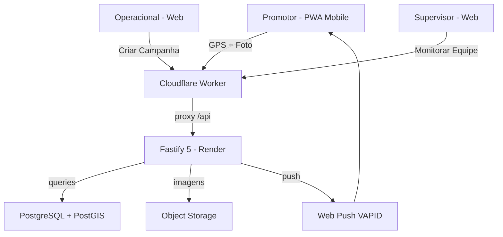

# Campin — SaaS de Gestão de Distribuição de Panfletos

> **Status:** Em produção · RC v1.10.0  
> Repositório principal privado — este repo é um showcase público.

---

## O Problema

Agências de distribuição de panfletos em São Paulo tipicamente operam com ferramentas desconexas:

- Um sistema de geomarketing pago para planejar regiões (ex: Geofusion)
- Grupos de WhatsApp para receber fotos dos promotores em campo
- Outro sistema pago para rastrear veículos e equipes (ex: We Trade)
- Rotas criadas manualmente no Google My Maps

O resultado: custo alto, informação dispersa, sem rastreabilidade real e muito trabalho manual de consolidação.

---

## A Solução

**Campin** é um SaaS multi-tenant construído do zero para substituir todos esses sistemas com uma única plataforma integrada.

### Funcionalidades principais

| Módulo | O que faz |
|--------|-----------|
| **Dashboard** | Visão em tempo real de todos os promotores ativos no mapa |
| **Campanhas** | CRUD completo com datas, clientes, lojas e materiais |
| **Check-in / Check-out** | Promotor registra entrada e saída por GPS via PWA |
| **Fotos** | Upload com geolocalização, organizado por campanha e promotor |
| **Supervisores** | Cada supervisor vê e gerencia apenas sua equipe |
| **Protocolo de entrega** | Documento imprimível em A4 (2 vias) com assinatura para comprovação de entrega por loja |
| **Push Notifications** | Alertas de campanhas e atualizações via Web Push (VAPID) |
| **Tutoriais** | Guia interativo com vídeos para todos os perfis de usuário |

---

## Perfis de Usuário

```
Admin          → controle total da plataforma, cadastros, relatórios
Operacional    → cria e monitora campanhas, acessa todos os promotores
Supervisor     → monitora sua equipe em campo, comunica com a base
Promotor       → usa o PWA no celular: check-in, fotos, check-out
```

---

## Stack Técnica

### Frontend
- **React 18** + Vite + Tailwind CSS
- **PWA** com Service Worker (`vite-plugin-pwa`, `injectManifest`)
  - Precache de assets, cache de mapas offline
  - Web Push Notifications (VAPID)
- **Cloudflare Workers** como runtime (`appcampin.com.br`)
  - Worker faz proxy de `/api/*` e `/uploads/*` → sem CORS
  - Cron Trigger a cada 10 minutos (keep-alive)

### Backend
- **Fastify 5** (Node.js)
- **PostgreSQL** + **PostGIS** (geofencing, coordenadas GPS)
- **Render** (plano pago, sem cold start)
- `@fastify/multipart` + `sharp` para upload e resize de imagens
- Migrações automáticas no startup (`migrate_startup.js`)

### Autenticação & Segurança
- JWT HS256 com expiração de 12h + cookie HttpOnly paralelo
- bcrypt v6 com 12 salt rounds
- AJV `additionalProperties: false` em todos os endpoints
- MIME type allowlist em todos os uploads
- Rate limiting em endpoints sensíveis
- `requireAuth` + `requireRole` por perfil em cada rota
- IDOR protection: todas as queries filtram por `tenant_id`

---

## Arquitetura

```
┌─────────────────────────────────────────────────────────┐
│                   Cloudflare Workers                    │
│   appcampin.com.br  /  site.appcampin.com.br           │
│                                                         │
│   React PWA (Vite) ──proxy──► Fastify API (Render)     │
│         │                           │                   │
│   Service Worker              PostgreSQL + PostGIS      │
│   Web Push (VAPID)            Uploads (storage)         │
└─────────────────────────────────────────────────────────┘
```



---

## Fluxo do Promotor (PWA)

```
Login → Ver campanha do dia → Check-in (GPS validado)
      → Tirar fotos com localização
      → Check-out → Registro finalizado
```

## Fluxo de Protocolo de Entrega

```
Configurar (logo + contato da agência) → Logo do cliente (por campanha)
→ Gerar PDF com 2 vias A4 → Imprimir → Assinar no campo
```

---

## Segurança

Suite de **116 testes automatizados** (71 unitários + 45 OWASP):

- SQL / NoSQL / Command Injection
- XSS refletido e armazenado
- Path Traversal (direto e URL-encoded)
- Prototype Pollution e Mass Assignment
- JWT: assinatura, expiração, alg:none
- CSRF, Session Fixation, Brute-force (rate limiting)
- Upload malicioso e double extension
- Security Headers, CORS, Open Redirect
- Payload excessivo e vazamento de dados sensíveis

---

## Estrutura do Projeto (simplificada)

```
campin/
├── frontend/
│   ├── src/
│   │   ├── pages/          # Login, Campaigns, Clients, CampaignDetail...
│   │   ├── components/     # Layout, Sidebar, UpdatePrompt...
│   │   ├── lib/            # api.js (HTTP + WebSocket), version.js
│   │   └── sw.js           # Service Worker
│   ├── worker.js           # Cloudflare Worker (proxy + cron)
│   └── wrangler.jsonc
├── backend/
│   └── src/
│       ├── routes/         # auth, campaigns, stores, clients, settings...
│       ├── middleware/     # auth.js (requireAuth, requireRole)
│       ├── db/             # index.js, migrate_startup.js
│       └── lib/            # storage.js, errorHandler.js
├── SiteCampin/             # Site institucional (Cloudflare Workers)
└── security-tests-jest/    # 30 testes OWASP (público)
```

---

## Deploy

| Serviço | Como |
|---------|------|
| Frontend (PWA) | `npm run build && npm run deploy` → Cloudflare Workers |
| Backend | Auto-deploy no Render a cada `git push origin main` |
| Site institucional | `npm run build && npx wrangler deploy` → Cloudflare Workers |

---

## Sobre

Desenvolvido por **Gui Furlaneti** — [LinkedIn](https://linkedin.com/in/gui-furlaneti) · [Portfolio](#)

Produto SaaS em produção ativo desde 2026.  
Repositório de código privado. Este showcase é público para referência.
