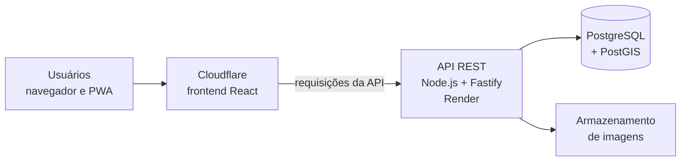

# Campin — Plataforma de Gestão Operacional

Plataforma web para gestão de campanhas de distribuição e de equipes de campo, idealizada e desenvolvida por **Guilherme Furlaneti** a partir de necessidades reais da Classe A, empresa onde trabalho.

> **Projeto autoral · em uso no contexto operacional da empresa · em evolução contínua**
>
> O código-fonte é privado. Este repositório é a apresentação técnica pública do projeto e **não contém o código da aplicação**.

---

## Problema

A operação de distribuição de materiais promocionais dependia de ferramentas separadas:

- planejamento de regiões em uma ferramenta de geomarketing;
- recebimento das fotos das equipes de campo por grupos de mensagens;
- acompanhamento das equipes em outra ferramenta;
- rotas montadas manualmente em mapas.

Com isso, as informações ficavam dispersas e a consolidação dos dados para acompanhar as campanhas e prestar contas era feita manualmente.

## Solução

O Campin reúne em uma única aplicação web o cadastro de campanhas, a gestão das equipes, os registros feitos em campo e o acompanhamento da operação.

Identifiquei a necessidade, idealizei a solução e desenvolvo o frontend, a API REST e a modelagem do banco de dados.

## Principais funcionalidades

Funcionalidades presentes na versão atual:

| Módulo | O que faz |
|--------|-----------|
| **Campanhas** | Cadastro de campanhas, com calendário e associação de clientes, lojas e equipes |
| **Áreas no mapa** | Delimitação das zonas de atuação de cada campanha |
| **Mapa ao vivo** | Acompanhamento das equipes em campo, com status como ativo, aguardando, parado e finalizado |
| **Registros de campo** | Registro de turnos e fotos pelos promotores, organizados por campanha |
| **Perfis de acesso** | Autenticação e permissões por perfil de usuário (por exemplo, administrador e supervisor) |
| **Relatórios** | Indicadores por campanha (promotores, turnos, cobertura de lojas, fotos e média de horas por turno), filtros por status e período e exportação em CSV |
| **Tutoriais** | Central de tutoriais em vídeo para os usuários |
| **Notificações** | Ativação de notificações no navegador |

## Tecnologias

| Camada | Tecnologias |
|--------|-------------|
| Frontend | React, JavaScript, PWA |
| Backend | Node.js, Fastify (API REST) |
| Banco de dados | PostgreSQL com PostGIS (dados geográficos) |
| Infraestrutura | Cloudflare (frontend e encaminhamento das requisições à API) e Render (API) |

## Arquitetura

- O **frontend React** é servido pela Cloudflare, que também encaminha as requisições da API para o backend.
- A **API REST em Fastify** concentra autenticação, regras de negócio e acesso aos dados.
- O **PostgreSQL com PostGIS** armazena os dados das campanhas e permite consultas geográficas.
- As **fotos** registradas em campo são enviadas pela API e mantidas em um serviço de armazenamento.

Práticas adotadas no backend:

- autenticação com JWT e senhas armazenadas com hash (bcrypt);
- verificação de autenticação e de perfil nas rotas da API;
- validação dos dados de entrada com JSON Schema;
- limitação de requisições em endpoints sensíveis.

## Código-fonte

O código da aplicação (frontend, API e banco de dados) é mantido em repositório privado, por se tratar de um sistema em uso na operação da empresa. Este repositório reúne apenas a documentação técnica do projeto. Detalhes de implementação podem ser apresentados em uma entrevista técnica.

## Autor

**Guilherme Furlaneti** — Desenvolvedor Backend

- Portfólio: [guifurlaneti.github.io/portfolio](https://guifurlaneti.github.io/portfolio/)
- LinkedIn: [linkedin.com/in/gui-furlaneti](https://www.linkedin.com/in/gui-furlaneti/)
- GitHub: [github.com/GuiFurlaneti](https://github.com/GuiFurlaneti)
